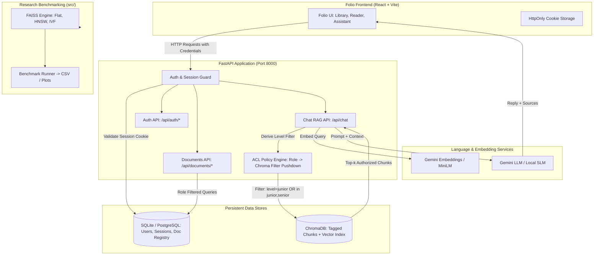

# Folio & DBS-Project: Complete Step-by-Step Implementation Plan

> **Target Goal:** Transform the prototype repository into a production-grade, access-controlled enterprise RAG engine (**Folio**) with role-based document segregation (Junior/Senior), multi-format ingestion (PDF, TXT, MD, Images/OCR), SQL-backed user and document registry, permission-aware vector retrieval pushdown, and a reproducible FAISS vector indexing benchmark suite (Flat vs. HNSW vs. IVF).

---

## 1. Executive Summary & Architectural Blueprint

### 1.1 Dual-Track System Architecture

The project consists of two complementary tracks:
1. **Folio Knowledge Engine (Enterprise Product)**:
   - **Frontend**: Role-aware React 18 + Vite 5 workspace in `frontend/`.
   - **Backend**: FastAPI service enforcing server-side session authentication (HttpOnly cookies), SQL user/document management, dual-layer metadata-filtered vector search in ChromaDB, and grounded Gemini/SLM generation.
   - **Access Segregation**: Two-tier Role-Based Access Control (**Junior** and **Senior**). Junior accounts access Junior-level documents only. Senior accounts inherit access to both Junior and Senior collections. Deny-by-default for unknown roles.
2. **Vector Indexing Research Track (`src/`)**:
   - Scientific evaluation of indexing trade-offs (Flat exhaustive search vs. HNSW graph ANN vs. IVF clustered ANN).
   - Evaluation metrics: Index build time, mean/p95/p99 query latency, Recall@K, and memory footprint.
   - Ground truth computed using exhaustive Flat inner-product search over normalized sentence embeddings (`all-MiniLM-L6-v2`).



---

## 2. Current State Inventory & Gap Analysis

| Component | Current State in Repository | Identified Gaps / Bugs | Required Fixes |
| :--- | :--- | :--- | :--- |
| **Frontend** (`frontend/`) | Fully implemented demo UI (login, library, reader, assistant, saved). Has live API adapter (`api.js`) and unit tests. | Default mode is `VITE_DATA_MODE=demo`. Needs backend implementation to activate `VITE_DATA_MODE=api`. | Configure `.env.local` pointing to `http://127.0.0.1:8000`. Verify CORS and credentials handling. |
| **Auth & Sessions** | Absent on backend. Simulated in frontend `sessionStorage`. | No server session store, no password verification, no cookie issuance. Direct API calls bypass access controls. | Implement SQLite `users` and `sessions` tables, bcrypt password hashing, and HttpOnly session cookies. |
| **Document Registry** | Only hardcoded in `frontend/src/data.js` (9 sample documents) and single PDF in `data/sample_document.pdf`. | No backend `GET /api/documents` or `GET /api/documents/:id`. No centralized document database. | Implement SQL `documents` table, seed canonical metadata, and expose role-enforced endpoints. |
| **Ingestion Pipeline** (`ingest.py`) | Basic PDF loader via LangChain and Chroma storage. | **Critical Flaw:** Does not attach metadata (`level`, `document_id`, `year`, `type`) to chunks! Only processes a single PDF. No multi-format support (TXT, MD, images). | Build multi-format ingestion module; attach comprehensive metadata to every chunk; persist to Chroma. |
| **RAG Backend** (`main.py`) | Basic FastAPI endpoint `POST /api/chat`. | 1. No authentication.<br>2. No role filtering on Chroma retriever (leaks all data).<br>3. Invalid imports (`langchain_classic`).<br>4. Non-existent model string (`gemini-3.5-flash`).<br>5. Missing `sources` in response. | Rewrite `main.py` using standard FastAPI dependencies, dynamic Chroma `$where` filters, valid Gemini model (`gemini-1.5-flash`), and structured source citations. |
| **Root Dependencies** (`requirements.txt`) | Contains only 4 packages (`sentence-transformers`, `faiss-cpu`, `numpy`, `pandas`). | Missing FastAPI, Uvicorn, SQLAlchemy, LangChain, ChromaDB, Google GenAI, PyPDF, and Passlib. | Update `requirements.txt` with pinned, compatible dependencies. |
| **Research Benchmark** (`src/`) | `chunking.py`, `embeddings.py`, `vector_index.py` exist. `benchmark.py` is **0 bytes empty**. | Benchmark suite cannot run; results CSV has only header. | Implement comprehensive `benchmark.py` calculating Latency (mean/p95/p99), Recall@K, Build Time, and Memory. |

---

## 3. Complete Project Directory Structure (Target State)

```
DBS-Project/
├── .env                              # Backend configuration (GEMINI_API_KEY, SECRET_KEY, DB_URL)
├── .env.example                      # Template for backend configuration
├── .gitignore                        # Git ignore rules (.env, .venv, chroma, node_modules)
├── README.md                         # Project documentation
├── STEP_BY_STEP_IMPLEMENTATION.md    # This master implementation plan
├── requirements.txt                  # Full backend & research Python dependencies
├── additional features.txt           # Feature backlog specification
├── main.py                           # FastAPI application entrypoint & API routes
├── ingest.py                         # Unified multi-format document ingestion script
│
├── database/                         # Database persistence & models
│   ├── __init__.py
│   ├── connection.py                 # SQLite engine & sessionmaker setup
│   ├── models.py                     # SQLAlchemy models (User, Session, Document)
│   └── seed.py                       # Database seeding script for initial users & docs
│
├── core/                             # Core backend utilities & security
│   ├── __init__.py
│   ├── auth.py                       # Password hashing & session management
│   ├── config.py                     # App settings (Pydantic settings)
│   └── dependencies.py               # FastAPI auth dependencies (get_current_user)
│
├── services/                         # Business logic services
│   ├── __init__.py
│   ├── rag_service.py                # Chroma retrieval with ACL filter pushdown & LLM chain
│   └── ocr_service.py                # Tesseract OCR extraction with fallback
│
├── data/                             # Knowledge base files & sample data
│   ├── sample_document.pdf           # Sample enterprise PDF
│   ├── sample_documents.txt          # Research corpus
│   ├── documents/                    # Additional ingested files (PDF, TXT, MD, images)
│   │   ├── junior/                   # Junior-tier documents
│   │   └── senior/                   # Senior-tier documents
│   └── folio.db                      # SQLite database file (generated)
│
├── chroma/                           # ChromaDB persistent vector storage (generated)
│
├── src/                              # Research track (FAISS indexing evaluation)
│   ├── __init__.py
│   ├── chunking.py                   # Word and token chunking utilities
│   ├── embeddings.py                 # Local sentence-transformers embeddings
│   ├── vector_index.py               # FAISS Flat, HNSW, IVF index builders
│   └── benchmark.py                  # Benchmarking harness (latency, recall, memory)
│
├── results/                          # Benchmark experimental outputs
│   └── benchmark_results.csv         # Recorded experimental metrics
│
└── frontend/                         # React 18 + Vite 5 workspace
    ├── .env.local                    # Local configuration (VITE_DATA_MODE=api)
    ├── API_CONTRACT.md               # Backend API specification contract
    ├── package.json
    ├── vite.config.js
    ├── src/
    │   ├── App.jsx                   # Application layout & routing
    │   ├── api.js                    # API client (demo vs. live adapter)
    │   ├── access.js                 # Role checks & UI filters
    │   ├── data.js                   # Preview data & fallback accounts
    │   └── Icons.jsx                 # SVG icon system
    └── tests/
        └── access.test.js            # Frontend unit tests
```

---

## 4. Phase-by-Phase Implementation Plan

---

### Phase 1: Environment & Dependency Harmonization

#### Objective
Ensure all required Python packages for both the product backend (FastAPI, ChromaDB, LangChain, SQLAlchemy, Gemini) and the research track (FAISS, SentenceTransformers) are declared and functional.

#### Step 1.1: Create Comprehensive `requirements.txt`
Replace the incomplete 4-line `requirements.txt` with a production-ready manifest:

```text
# Web Framework & API
fastapi>=0.110.0,<0.115.0
uvicorn[standard]>=0.29.0,<0.32.0
python-multipart>=0.0.9
pydantic>=2.6.0,<3.0.0
pydantic-settings>=2.2.0

# Database & Authentication
sqlalchemy>=2.0.28,<2.1.0
passlib[bcrypt]>=1.7.4
bcrypt>=4.1.2,<4.2.0
python-jose[cryptography]>=3.3.0

# LLM & Vector Store (Product Path)
langchain>=0.2.0,<0.4.0
langchain-community>=0.2.0,<0.4.0
langchain-core>=0.2.0,<0.4.0
langchain-chroma>=0.1.0,<0.3.0
langchain-google-genai>=1.0.0,<2.1.0
google-generativeai>=0.5.0
chromadb>=0.5.0,<0.6.0
python-dotenv>=1.0.1

# Document Loaders & Image Processing
pypdf>=4.2.0
pillow>=10.2.0
pytesseract>=0.3.10

# Research & Benchmarking Track
sentence-transformers>=2.6.0,<3.3.0
faiss-cpu>=1.8.0
numpy>=1.26.0,<2.0.0
pandas>=2.2.0
psutil>=5.9.8

# Quality Assurance
pytest>=8.1.0
httpx>=0.27.0
```

#### Step 1.2: Environment Setup Commands
```bash
# 1. Create a dedicated Python virtual environment
python3 -m venv .venv
source .venv/bin/activate

# 2. Upgrade pip and install dependencies
pip install --upgrade pip
pip install -r requirements.txt

# 3. Create root .env file from template
cat << 'EOF' > .env
GEMINI_API_KEY=your_gemini_api_key_here
SECRET_KEY=folio-enterprise-secret-key-change-in-production-2026
ENVIRONMENT=development
DATABASE_URL=sqlite:///./data/folio.db
CORS_ORIGINS=http://localhost:5173,http://127.0.0.1:5173
EMBEDDING_PROVIDER=gemini
LLM_PROVIDER=gemini
LLM_MODEL=gemini-1.5-flash
EOF
```

---

### Phase 2: Database Layer & Secure Session Management

#### Objective
Implement an SQL database (SQLite with SQLAlchemy) to store canonical user accounts, hashed credentials, active sessions, and document registry records.

#### Step 2.1: Implement Connection Engine (`database/connection.py`)
```python
import os
from sqlalchemy import create_engine
from sqlalchemy.orm import declarative_base, sessionmaker

DATABASE_URL = os.getenv("DATABASE_URL", "sqlite:///./data/folio.db")

# For SQLite, allow multi-threaded access for FastAPI async handlers
connect_args = {"check_same_thread": False} if DATABASE_URL.startswith("sqlite") else {}

engine = create_engine(DATABASE_URL, connect_args=connect_args)
SessionLocal = sessionmaker(autocommit=False, autoflush=False, bind=engine)
Base = declarative_base()

def get_db():
    """FastAPI dependency for yielding database sessions."""
    db = SessionLocal()
    try:
        yield db
    finally:
        db.close()
```

#### Step 2.2: Define Database Models (`database/models.py`)
```python
import datetime
from sqlalchemy import Column, DateTime, ForeignKey, Integer, String, Text
from sqlalchemy.orm import relationship
from database.connection import Base

class User(Base):
    __tablename__ = "users"

    id = Column(String(64), primary_key=True, index=True)
    name = Column(String(128), nullable=False)
    email = Column(String(128), unique=True, index=True, nullable=False)
    password_hash = Column(String(256), nullable=False)
    role = Column(String(16), nullable=False)  # "junior" or "senior"
    created_at = Column(DateTime, default=datetime.datetime.utcnow)

    sessions = relationship("Session", back_populates="user", cascade="all, delete-orphan")

class Session(Base):
    __tablename__ = "sessions"

    id = Column(String(128), primary_key=True, index=True)  # Cryptographic session token
    user_id = Column(String(64), ForeignKey("users.id"), nullable=False)
    created_at = Column(DateTime, default=datetime.datetime.utcnow)
    expires_at = Column(DateTime, nullable=False)

    user = relationship("User", back_populates="sessions")

class Document(Base):
    __tablename__ = "documents"

    id = Column(String(64), primary_key=True, index=True)  # URL-safe ID e.g. "team-handbook"
    title = Column(String(256), nullable=False)
    description = Column(Text, nullable=True)
    category = Column(String(64), nullable=False)
    type = Column(String(32), nullable=False)              # "Guide", "Policy", "Playbook", etc.
    year = Column(String(8), nullable=False)               # "2025", "2026"
    level = Column(String(16), nullable=False)             # "junior" or "senior"
    date = Column(String(16), nullable=False)              # ISO date "YYYY-MM-DD"
    minutes = Column(Integer, default=5)
    author = Column(String(128), nullable=False)
    content = Column(Text, nullable=False)
    file_path = Column(String(256), nullable=True)
    created_at = Column(DateTime, default=datetime.datetime.utcnow)
```

#### Step 2.3: Security & Session Helper (`core/auth.py`)
- Password hashing with `passlib.context.CryptContext(schemes=["bcrypt"])`.
- Session issuance: Cryptographically secure 48-byte token (`secrets.token_urlsafe(32)`).
- Session expiration: 7 days default.
- Verification logic: Fetch session by ID, ensure `expires_at > datetime.utcnow()`, and return the associated `User`.

#### Step 2.4: Seed Database (`database/seed.py`)
Populate the database with:
1. **Accounts**:
   - Junior: `junior@folio.demo` / `Junior@123` (Name: "Alex Morgan", Role: "junior")
   - Senior: `senior@folio.demo` / `Senior@123` (Name: "Taylor Reed", Role: "senior")
2. **Documents**:
   - The 9 canonical documents from `frontend/src/data.js`:
     - Junior (6): `getting-started`, `team-handbook`, `security-basics`, `project-playbook`, `brand-guide`, `review-template`.
     - Senior (3): `leadership-strategy`, `resource-planning`, `quarterly-review`.
   - Any external PDFs in `data/`.

---

### Phase 3: Multi-Format Ingestion Engine & Tagged ChromaDB Vector Store

#### Objective
Upgrade `ingest.py` from an unsegregated PDF script into an enterprise ingestion pipeline capable of ingesting PDF, Markdown, TXT, and images (via OCR), chunking documents semantically, and tagging every chunk with exact metadata for vector-level filtering.

#### Step 3.1: Chunking & Metadata Attachment Strategy
Each chunk stored in ChromaDB must include the following metadata dictionary:
```json
{
  "document_id": "team-handbook",
  "title": "The team handbook",
  "level": "junior",
  "category": "People & culture",
  "type": "Policy",
  "year": "2026",
  "chunk_index": 0
}
```

#### Step 3.2: Multi-Format Ingestion Pipeline Implementation (`ingest.py`)
```python
import os
import glob
from pathlib import Path
from dotenv import load_dotenv
from langchain_text_splitters import RecursiveCharacterTextSplitter
from langchain_chroma import Chroma
from langchain_community.document_loaders import PyPDFLoader
from database.connection import SessionLocal
from database.models import Document

load_dotenv()

def get_embedding_model():
    provider = os.getenv("EMBEDDING_PROVIDER", "gemini").lower()
    if provider == "gemini":
        from langchain_google_genai import GoogleGenerativeAIEmbeddings
        api_key = os.getenv("GEMINI_API_KEY")
        if not api_key:
            raise ValueError("GEMINI_API_KEY is missing from .env")
        return GoogleGenerativeAIEmbeddings(model="models/embedding-001")
    else:
        from langchain_community.embeddings import HuggingFaceEmbeddings
        return HuggingFaceEmbeddings(model_name="sentence-transformers/all-MiniLM-L6-v2")

def ingest_all():
    """
    1. Read canonical documents from SQL database.
    2. Read external documents from data/ directory.
    3. Split into 800-character chunks with 150-character overlap.
    4. Attach rich metadata (document_id, title, level, type, year).
    5. Save to ChromaDB at ./chroma.
    """
    db = SessionLocal()
    docs = db.query(Document).all()
    
    splitter = RecursiveCharacterTextSplitter(
        chunk_size=800,
        chunk_overlap=150,
        length_function=len
    )
    
    all_chunks = []
    all_metadatas = []
    all_ids = []
    
    for doc in docs:
        chunks = splitter.split_text(doc.content)
        for idx, chunk_text in enumerate(chunks):
            chunk_id = f"{doc.id}_chunk_{idx}"
            metadata = {
                "document_id": doc.id,
                "title": doc.title,
                "level": doc.level,
                "category": doc.category,
                "type": doc.type,
                "year": str(doc.year),
                "chunk_index": idx
            }
            all_chunks.append(chunk_text)
            all_metadatas.append(metadata)
            all_ids.append(chunk_id)
            
    # Also process external PDF files if present in data/
    # Tag them according to their target directory (e.g. data/documents/junior/*.pdf)
    
    print(f"Total chunks to vectorize: {len(all_chunks)}")
    embed_model = get_embedding_model()
    
    vector_db = Chroma(
        persist_directory="./chroma",
        embedding_function=embed_model
    )
    
    # Upsert chunks into Chroma
    vector_db.add_texts(
        texts=all_chunks,
        metadatas=all_metadatas,
        ids=all_ids
    )
    print("Ingestion complete. Vector database populated.")
```

#### Step 3.3: Image Ingestion with OCR Fallback (`services/ocr_service.py`)
```python
def extract_text_from_image(image_path: str) -> str:
    """Extract text using pytesseract if installed, otherwise log warning."""
    try:
        from PIL import Image
        import pytesseract
        image = Image.open(image_path)
        return pytesseract.image_to_string(image)
    except Exception as e:
        print(f"OCR warning: Could not extract text from {image_path}: {e}")
        return ""
```

---

### Phase 4: Production FastAPI Application & API Contract Implementation

#### Objective
Implement the complete backend API in `main.py` fulfilling 100% of the contract defined in `frontend/API_CONTRACT.md`.

#### Step 4.1: Authentication & Authorization Dependencies (`core/dependencies.py`)
```python
from fastapi import Request, HTTPException, status, Depends
from sqlalchemy.orm import Session
from database.connection import get_db
from core.auth import get_user_from_session
from database.models import User

SESSION_COOKIE_NAME = "folio_session"

def get_current_user(request: Request, db: Session = Depends(get_db)) -> User:
    """Validate HttpOnly session cookie and return active User."""
    session_id = request.cookies.get(SESSION_COOKIE_NAME)
    if not session_id:
        raise HTTPException(
            status_code=status.HTTP_401_UNAUTHORIZED,
            detail="Your session has expired. Please sign in again."
        )
    user = get_user_from_session(db, session_id)
    if not user:
        raise HTTPException(
            status_code=status.HTTP_401_UNAUTHORIZED,
            detail="Your session has expired. Please sign in again."
        )
    return user
```

#### Step 4.2: Endpoints Implementation (`main.py`)

##### 1. CORS Setup
```python
app.add_middleware(
    CORSMiddleware,
    allow_origins=["http://127.0.0.1:5173", "http://localhost:5173"],
    allow_credentials=True,
    allow_methods=["*"],
    allow_headers=["*"],
)
```

##### 2. Authentication Endpoints
- `POST /api/auth/login`:
  - Request: `{"email": "...", "password": "..."}`
  - Validates credentials against SQL `users`.
  - Generates new session token in SQL `sessions`.
  - Sets HttpOnly cookie: `response.set_cookie(key="folio_session", value=token, httponly=True, samesite="lax", secure=False)`.
  - Response (200): `{"id": user.id, "name": user.name, "email": user.email, "role": user.role}`.
  - Invalid credentials return 401.
- `GET /api/auth/me`:
  - Protected by `Depends(get_current_user)`.
  - Returns current user JSON or 401.
- `POST /api/auth/logout`:
  - Revokes session record in SQL.
  - Deletes cookie: `response.delete_cookie(key="folio_session", path="/")`.
  - Returns 204 No Content.

##### 3. Document Endpoints
- `GET /api/documents`:
  - Protected by `user: User = Depends(get_current_user)`.
  - Query:
    - If `user.role == "junior"`: `db.query(Document).filter(Document.level == "junior").all()`
    - If `user.role == "senior"`: `db.query(Document).filter(Document.level.in_(["junior", "senior"])).all()`
  - Returns list of document metadata objects (excluding or including summary `content`).
- `GET /api/documents/{id}`:
  - Protected by `user: User = Depends(get_current_user)`.
  - Fetches document by ID.
  - Returns 404 if not found.
  - Enforces access: If `doc.level == "senior"` and `user.role == "junior"`, return **403 Forbidden**.
  - Returns full document object including `content`.

##### 4. Permission-Aware Assistant Endpoint (`POST /api/chat`)
- Input: `ChatRequest(message: str, document_id: Optional[str] = None)`
- Protected by `user: User = Depends(get_current_user)`.
- ACL Vector Filter Pushdown:
  ```python
  # Construct Chroma 'where' filter based on role and optional document scope
  if user.role == "junior":
      level_filter = {"level": "junior"}
  elif user.role == "senior":
      level_filter = {"level": {"$in": ["junior", "senior"]}}
  else:
      raise HTTPException(status_code=403, detail="Unauthorized role.")

  if req.document_id:
      # Verify that user has access to this document
      scoped_doc = db.query(Document).filter(Document.id == req.document_id).first()
      if not scoped_doc or (scoped_doc.level == "senior" and user.role == "junior"):
          raise HTTPException(status_code=403, detail="Access denied to requested document.")
      chroma_where = {"$and": [level_filter, {"document_id": req.document_id}]}
  else:
      chroma_where = level_filter
  ```
- Vector Search:
  ```python
  results = vector_db.similarity_search(
      query=req.message,
      k=3,
      filter=chroma_where
  )
  ```
- Grounded Prompting & Generation:
  Pass authorized context chunks into Gemini (`gemini-1.5-flash`) with prompt:
  ```
  You are the Folio knowledge assistant. Answer the user's question using ONLY the provided context from their authorized documents.
  If the answer is not contained in the context, do not guess or extrapolate. Say: "I cannot find this in your documents."

  Context:
  {context}

  Question:
  {question}

  Answer:
  ```
- Source Attribution:
  Extract unique sources from `results.metadatas`:
  `sources = [{"id": r.metadata["document_id"], "title": r.metadata["title"]} for r in results]`
- Response:
  ```json
  {
    "reply": "...",
    "sources": [{"id": "team-handbook", "title": "The team handbook"}]
  }
  ```

---

### Phase 5: Frontend Live Mode Integration & Testing

#### Objective
Connect the React + Vite frontend to the FastAPI backend and verify seamless cookie authentication and role segregation.

#### Step 5.1: Configure Frontend Environment
In `frontend/`:
```bash
cp .env.example .env.local
```
Set contents of `frontend/.env.local`:
```ini
VITE_DATA_MODE=api
VITE_API_BASE_URL=http://127.0.0.1:8000
```

#### Step 5.2: Verification Workflow
1. Run backend: `uvicorn main:app --host 127.0.0.1 --port 8000 --reload`
2. Run frontend: `npm run dev -- --host 127.0.0.1`
3. Open browser at `http://127.0.0.1:5173`.
4. Sign in as `junior@folio.demo`:
   - Verify Library shows exactly 6 Junior documents.
   - Verify Senior documents (`leadership-strategy`, etc.) do not appear.
   - Attempt direct URL `#documents/leadership-strategy` -> verifies 403 Forbidden reader error.
   - Open AI Assistant, ask: *"What are the 2027 investment priorities?"* -> Assistant states it cannot find it in documents.
5. Sign in as `senior@folio.demo`:
   - Verify Library shows all 9 documents.
   - Open AI Assistant, ask the same question -> Assistant provides answers cited from `leadership-strategy`.

---

### Phase 6: Research Track — FAISS Vector Indexing Benchmark Suite (`src/benchmark.py`)

#### Objective
Implement the missing benchmarking harness in `src/benchmark.py` to compare Flat, HNSW, and IVF index strategies across corpus sizes.

#### Step 6.1: Implementation Details (`src/benchmark.py`)
1. **Corpus Preparation**:
   - Load `data/sample_documents.txt`.
   - Chunk using `src/chunking.py`.
   - Generate normalized 384-dimensional embeddings using `src/embeddings.py` (`all-MiniLM-L6-v2`).
   - Synthetically expand or replicate corpus to benchmark realistic scales (e.g., 500, 2,000, 10,000 vectors).
2. **Index Construction**:
   - **Flat**: `faiss.IndexFlatIP(dimension)` (Exact ground truth, $O(N)$ query time).
   - **HNSW**: `faiss.IndexHNSWFlat(dimension, M=32, faiss.METRIC_INNER_PRODUCT)` ($O(\log N)$ graph search).
   - **IVF**: `faiss.IndexIVFFlat(quantizer, dimension, nlist=16, faiss.METRIC_INNER_PRODUCT)` (Cluster-based inverted file index).
3. **Metrics Computed**:
   - **Build / Indexing Time**: Time in milliseconds to train and add vectors to the index.
   - **Query Latency**: Measure 100 sample queries; record mean, p95, and p99 query latency in ms.
   - **Recall@K ($k=5$)**:
     $$\text{Recall@}K = \frac{|\text{Retrieved Top-}K \cap \text{Ground Truth Top-}K|}{K}$$
     Ground truth is established by the exhaustive Flat index.
   - **Memory Usage**: RAM footprint estimated via index serialization size (`faiss.serialize_index`) or `psutil`.
4. **Output Generation**:
   - Save results to `results/benchmark_results.csv`.
   - Print a Markdown comparison table.

#### Step 6.2: Benchmark Execution Script
```python
# src/benchmark.py structure
import time
import psutil
import numpy as np
import pandas as pd
from src.chunking import load_document, chunk_text
from src.embeddings import generate_embeddings
from src.vector_index import create_flat_index, create_hnsw_index, create_ivf_index

def run_benchmarks():
    # 1. Load & embed data
    # 2. Build indexes & record time
    # 3. Query & compute Recall@K against Flat
    # 4. Save to results/benchmark_results.csv
```

---

## 5. Security & Acceptance Verification Checklist

| Check # | Requirement | Test Procedure | Expected Outcome |
| :---: | :--- | :--- | :--- |
| **AC-1** | Junior cannot fetch Senior document by guessing ID | Send `GET /api/documents/leadership-strategy` with Junior session cookie. | Server returns `403 Forbidden`. UI displays error screen. |
| **AC-2** | Chat never exposes Senior-only facts to Junior | Send `POST /api/chat` with question on senior strategy using Junior session. | Chroma retrieval receives `where={"level": "junior"}`; LLM context contains 0 senior chunks; answers "I cannot find this in your documents". |
| **AC-3** | Senior session retrieves both levels | Send `GET /api/documents` and query chat using Senior session. | Returns 9 documents; chat successfully retrieves from both Junior and Senior corpora. |
| **AC-4** | Client tampering cannot elevate role | Modify request payload or `sessionStorage` in browser to send `"role": "senior"`. | Server ignores request body; derives role strictly from validated session cookie in SQLite. |
| **AC-5** | Logout and expiration invalidate session | Call `POST /api/auth/logout`, then call `GET /api/auth/me`. | Returns `401 Unauthorized`; cookie cleared. |
| **AC-6** | CORS and origin protection | Send requests from unauthorized origin (e.g. `http://malicious-site.com`). | CORS middleware rejects preflight / cross-origin request. |

---

## 6. End-to-End Execution Runbook

Follow these exact commands from the repository root:

```bash
# ---------------------------------------------------------
# Step 1: Environment Setup
# ---------------------------------------------------------
python3 -m venv .venv
source .venv/bin/activate
pip install -r requirements.txt

# ---------------------------------------------------------
# Step 2: Seed Database
# ---------------------------------------------------------
python -m database.seed

# ---------------------------------------------------------
# Step 3: Run Document Ingestion (Chroma Vector Database)
# ---------------------------------------------------------
python ingest.py

# ---------------------------------------------------------
# Step 4: Run FAISS Research Benchmark
# ---------------------------------------------------------
python -m src.benchmark

# ---------------------------------------------------------
# Step 5: Start Backend API Service
# ---------------------------------------------------------
uvicorn main:app --host 127.0.0.1 --port 8000 --reload

# ---------------------------------------------------------
# Step 6: Start Frontend (in a separate terminal)
# ---------------------------------------------------------
cd frontend
cp .env.example .env.local
# Ensure .env.local has:
# VITE_DATA_MODE=api
# VITE_API_BASE_URL=http://127.0.0.1:8000
npm install
npm test
npm run dev -- --host 127.0.0.1
```
