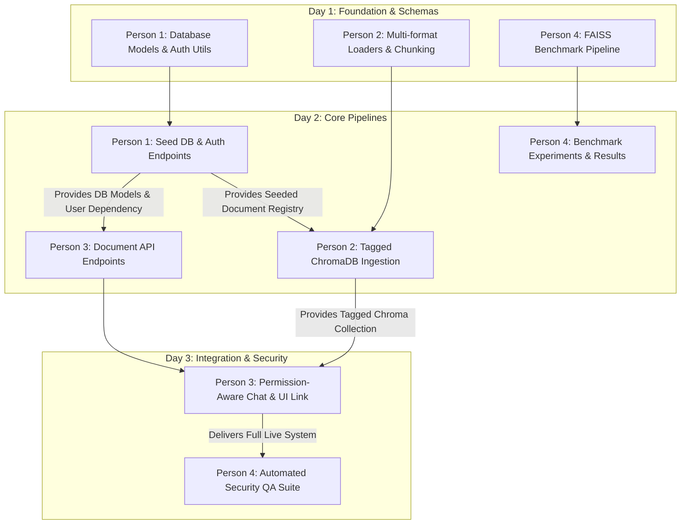

# Folio & DBS-Project: 4-Person Team Task Division & Execution Guide

This document divides the complete implementation of the **Folio Access-Controlled RAG Knowledge Engine** and the **FAISS Vector Indexing Research Track** among four developers. It directly references the architecture and phases in [`STEP_BY_STEP_IMPLEMENTATION.md`](./STEP_BY_STEP_IMPLEMENTATION.md), [`README.md`](./README.md), and [`frontend/API_CONTRACT.md`](./frontend/API_CONTRACT.md).

---

## Team Overview & Dependency Flow



---

## Person 1: Backend Infrastructure, SQL Database & Authentication Engineer

### 1. Scope & Ownership
- **Primary Focus**: Infrastructure setup, SQL database persistence (SQLite via SQLAlchemy), password security, session token issuance, HttpOnly cookie lifecycle, and `/api/auth/*` endpoints.
- **Reference**: `STEP_BY_STEP_IMPLEMENTATION.md` → **Phase 1** & **Phase 2**.
- **Assigned Files**:
  - [`requirements.txt`](./requirements.txt)
  - `.env` & `.env.example`
  - `database/connection.py`
  - `database/models.py`
  - `database/seed.py`
  - `core/auth.py`
  - `core/dependencies.py`
  - Relevant auth routes in [`main.py`](./main.py)

### 2. Detailed Step-by-Step Instructions

#### Task 1.1: Harmonize Dependencies & Environment Configuration
- Update [`requirements.txt`](./requirements.txt) with the full dependency manifest specified in Phase 1 of `STEP_BY_STEP_IMPLEMENTATION.md`.
- Create `.env.example` and set up the active `.env` file with `DATABASE_URL=sqlite:///./data/folio.db`, `SECRET_KEY`, and `ENVIRONMENT=development`.
- Verify clean virtual environment setup:
  ```bash
  python3 -m venv .venv
  source .venv/bin/activate
  pip install -r requirements.txt
  ```

#### Task 1.2: Database Engine & ORM Models
- Create `database/connection.py`:
  - Define SQLite connection engine with `check_same_thread=False` and `SessionLocal` factory.
  - Implement the `get_db()` generator dependency.
- Create `database/models.py` defining SQLAlchemy models:
  - [`User`](./STEP_BY_STEP_IMPLEMENTATION.md#step-22-define-database-models-databasemodelspy): `id` (string), `name`, `email` (unique index), `password_hash`, `role` (`"junior"` or `"senior"`), `created_at`.
  - [`Session`](./STEP_BY_STEP_IMPLEMENTATION.md#step-22-define-database-models-databasemodelspy): `id` (token, string, primary key), `user_id` (foreign key), `created_at`, `expires_at`.
  - [`Document`](./STEP_BY_STEP_IMPLEMENTATION.md#step-22-define-database-models-databasemodelspy): `id` (slug string e.g. `"team-handbook"`), `title`, `description`, `category`, `type`, `year`, `level` (`"junior"` or `"senior"`), `date`, `minutes`, `author`, `content`, `file_path`.

#### Task 1.3: Authentication Utilities & FastAPI Dependencies
- Create `core/auth.py`:
  - Setup `passlib.context.CryptContext(schemes=["bcrypt"])` for `hash_password(raw)` and `verify_password(raw, hashed)`.
  - Implement `create_session(db, user_id, duration_days=7)` generating a cryptographically secure token using `secrets.token_urlsafe(32)`.
  - Implement `get_user_from_session(db, session_id)` validating expiration (`expires_at > now`).
  - Implement `revoke_session(db, session_id)` for logout.
- Create `core/dependencies.py`:
  - Implement `get_current_user(request: Request, db: Session = Depends(get_db)) -> User`:
    - Read cookie `folio_session`.
    - If cookie is missing or invalid/expired, raise `HTTPException(status_code=401, detail="Your session has expired. Please sign in again.")`.
  - Implement `require_role(allowed_roles: list[str])` helper for role-based route gating.

#### Task 1.4: Database Seeding Script
- Create `database/seed.py`:
  - Initialize database tables with `Base.metadata.create_all(bind=engine)`.
  - Seed initial accounts matching `frontend/src/data.js`:
    - `junior@folio.demo` / `Junior@123` (Name: "Alex Morgan", Role: "junior")
    - `senior@folio.demo` / `Senior@123` (Name: "Taylor Reed", Role: "senior")
  - Seed initial 9 canonical documents (6 Junior, 3 Senior) from `frontend/src/data.js`.

#### Task 1.5: Auth Endpoints in `main.py`
- In [`main.py`](./main.py), configure CORS with explicit origins `['http://127.0.0.1:5173', 'http://localhost:5173']` and `allow_credentials=True`.
- Implement endpoints adhering strictly to [`frontend/API_CONTRACT.md`](./frontend/API_CONTRACT.md):
  - `POST /api/auth/login`: Accepts `{"email": "...", "password": "..."}`. Returns 401 on bad credentials. Sets `folio_session` HttpOnly cookie (`httponly=True, samesite="lax", secure=False, path="/"`) and returns `{id, name, email, role}`.
  - `GET /api/auth/me`: Protected by `Depends(get_current_user)`. Returns `{id, name, email, role}`.
  - `POST /api/auth/logout`: Revokes session, calls `response.delete_cookie("folio_session", path="/")`, and returns status 204.

### 3. Deliverables & Handoff
- **Handoff to Person 2**: Seeded SQLite database at `data/folio.db` populated with document records.
- **Handoff to Person 3**: Reusable `get_current_user` dependency and working auth cookie sessions.
- **Self-Verification**:
  ```bash
  python -m database.seed
  # Run a test login curl to verify 200 OK + Set-Cookie header:
  curl -i -X POST http://127.0.0.1:8000/api/auth/login \
    -H "Content-Type: application/json" \
    -d '{"email":"junior@folio.demo","password":"Junior@123"}'
  ```

---

## Person 2: Multi-Format Ingestion & Tagged Vector Database Engineer

### 1. Scope & Ownership
- **Primary Focus**: Document loaders (PDF, TXT, Markdown, Images via OCR), semantic text chunking, attaching rich metadata dictionaries to vector chunks, and populating ChromaDB storage at `./chroma`.
- **Reference**: `STEP_BY_STEP_IMPLEMENTATION.md` → **Phase 3** & `additional features.txt` (items 4, 6, 7).
- **Assigned Files**:
  - [`ingest.py`](./ingest.py)
  - `services/ocr_service.py`
  - `data/documents/` (directory organization for sample files)
  - `./chroma` directory and collection schema

### 2. Detailed Step-by-Step Instructions

#### Task 2.1: Multi-Format Document Loading & OCR Service
- Create `services/ocr_service.py`:
  - Implement `extract_text_from_image(path)` using `PIL.Image` and `pytesseract`.
  - Add graceful error handling if Tesseract binary is not installed on the host system.
- Build format-specific loaders in `ingest.py`:
  - PDF: Use `pypdf` or `langchain_community.document_loaders.PyPDFLoader`.
  - Plain Text & Markdown: Load UTF-8 content directly from `.txt` and `.md` files.
  - Images: Use `services/ocr_service.py` for `.png`, `.jpg`, `.jpeg`.
  - SQL Registry Loader: Load content directly from the `documents` table created by Person 1.

#### Task 2.2: Text Splitting & Metadata Injection Strategy
- Configure `RecursiveCharacterTextSplitter`:
  - `chunk_size = 800`
  - `chunk_overlap = 150`
  - `length_function = len`
- **Crucial Rule (No Hallucination)**: Vector access control depends entirely on Chroma metadata filter pushdown. Every single chunk pushed to Chroma **MUST** contain this exact metadata structure:
  ```python
  metadata = {
      "document_id": doc.id,         # e.g. "team-handbook"
      "title": doc.title,             # e.g. "The team handbook"
      "level": doc.level,             # MUST be "junior" or "senior"
      "category": doc.category,       # e.g. "People & culture"
      "type": doc.type,               # e.g. "Policy"
      "year": str(doc.year),          # e.g. "2026"
      "chunk_index": idx              # Integer sequence index
  }
  ```

#### Task 2.3: Embedding Model Selector & ChromaDB Persistence
- In `ingest.py`, build the embedding selector:
  - If `EMBEDDING_PROVIDER=gemini`: use `GoogleGenerativeAIEmbeddings(model="models/embedding-001")`.
  - If `EMBEDDING_PROVIDER=local`: use `HuggingFaceEmbeddings(model_name="sentence-transformers/all-MiniLM-L6-v2")`.
- Initialize persistent Chroma client:
  ```python
  from langchain_chroma import Chroma
  vector_db = Chroma(
      persist_directory="./chroma",
      embedding_function=embed_model,
      collection_name="folio_knowledge_base"
  )
  ```
- Clear or upsert chunks with deterministic IDs (`f"{doc.id}_chunk_{idx}"`) to allow idempotent re-indexing without duplicate vectors.

#### Task 2.4: Build Ingestion CLI & Verification Tool
- In `ingest.py`, implement a `__main__` entrypoint that:
  1. Queries all documents from SQL database (`database/models.py`).
  2. Scans `data/documents/` for external files.
  3. Splits texts and vectorizes chunks into `./chroma`.
  4. Runs a verification test:
     - Query with `where={"level": "junior"}` -> Confirm 0 senior documents are returned.
     - Query with `where={"level": "senior"}` -> Confirm senior documents are returned.

### 3. Deliverables & Handoff
- **Handoff to Person 3**: Persisted ChromaDB directory `./chroma` with verified `level`, `year`, `type`, and `document_id` metadata on every chunk.
- **Self-Verification**:
  ```bash
  python ingest.py
  # Verify metadata filtering directly:
  python -c '
  from langchain_chroma import Chroma
  from ingest import get_embedding_model
  v = Chroma(persist_directory="./chroma", embedding_function=get_embedding_model(), collection_name="folio_knowledge_base")
  hits = v.similarity_search("strategy", k=5, filter={"level": "junior"})
  assert all(h.metadata["level"] == "junior" for h in hits)
  print("Metadata filter pushdown verified!")
  '
  ```

---

## Person 3: RAG API, ACL Retrieval & Frontend Integration Engineer

### 1. Scope & Ownership
- **Primary Focus**: Document retrieval endpoints (`/api/documents/*`), permission-aware RAG pipeline (`POST /api/chat`), LLM prompt construction, structured source citations, and end-to-end integration with the React frontend in live API mode.
- **Reference**: `STEP_BY_STEP_IMPLEMENTATION.md` → **Phase 4** & **Phase 5**, [`frontend/API_CONTRACT.md`](./frontend/API_CONTRACT.md).
- **Assigned Files**:
  - [`main.py`](./main.py)
  - `services/rag_service.py`
  - `frontend/.env.local`
  - Integration testing with `frontend/src/api.js`

### 2. Detailed Step-by-Step Instructions

#### Task 3.1: Document Management API Endpoints
In [`main.py`](./main.py), implement document routes:
- `GET /api/documents`:
  - Inject `current_user: User = Depends(get_current_user)`.
  - If `current_user.role == "junior"`: query documents where `level == 'junior'`.
  - If `current_user.role == "senior"`: query documents where `level.in_(['junior', 'senior'])`.
  - Return JSON array matching [`API_CONTRACT.md`](./frontend/API_CONTRACT.md#documents).
- `GET /api/documents/{id}`:
  - Inject `current_user: User = Depends(get_current_user)`.
  - Fetch document by `id`. Return 404 if not found.
  - **Security Gate**: If `doc.level == "senior"` and `current_user.role == "junior"`, return **403 Forbidden** (`{"detail": "You do not have permission to access this content."}`).
  - Return document object including full `content` text.

#### Task 3.2: Implement ACL Filter Pushdown in `services/rag_service.py`
- Create `services/rag_service.py` to encapsulate Chroma query construction and LLM chain invocation:
  ```python
  def build_acl_filter(user_role: str, document_id: Optional[str] = None) -> dict:
      if user_role == "junior":
          level_filter = {"level": "junior"}
      elif user_role == "senior":
          level_filter = {"level": {"$in": ["junior", "senior"]}}
      else:
          raise PermissionError("Invalid user role")

      if document_id:
          return {"$and": [level_filter, {"document_id": document_id}]}
      return level_filter
  ```
- Vector Query Execution:
  - Use `vector_db.similarity_search(query=req.message, k=3, filter=acl_filter)`.
  - Defense-in-depth: Post-retrieval verification that no chunk in results has `level == "senior"` if `current_user.role == "junior"`.

#### Task 3.3: LLM Prompt Engineering & Source Citations
- Wire Gemini generation via `ChatGoogleGenerativeAI(model="gemini-1.5-flash", api_key=GEMINI_API_KEY)`.
- Configure strict prompt:
  ```
  You are the Folio knowledge assistant. Answer the user's question using ONLY the provided context from their authorized documents.
  If the answer cannot be found in the context, do not speculate or use outside knowledge. Say: "I cannot find this in your documents."

  Context:
  {context}

  Question:
  {question}

  Answer:
  ```
- Build response payload:
  - Deduplicate document sources from chunk metadata.
  - Return `{ "reply": answer_text, "sources": [{"id": doc_id, "title": title}, ...] }`.

#### Task 3.4: Wire `POST /api/chat` Route
- Route signature in `main.py`:
  ```python
  class ChatRequest(BaseModel):
      message: str
      document_id: Optional[str] = None

  @app.post("/api/chat")
  async def chat_endpoint(
      req: ChatRequest,
      user: User = Depends(get_current_user),
      db: Session = Depends(get_db)
  ):
      # Validate document_id if provided
      if req.document_id:
          doc = db.query(Document).filter(Document.id == req.document_id).first()
          if not doc or (doc.level == "senior" and user.role == "junior"):
              raise HTTPException(status_code=403, detail="Document inaccessible.")
      
      return rag_service.query_rag(query=req.message, user_role=user.role, document_id=req.document_id)
  ```

#### Task 3.5: Frontend Live Mode Integration
- In `frontend/`:
  - Create `frontend/.env.local`:
    ```ini
    VITE_DATA_MODE=api
    VITE_API_BASE_URL=http://127.0.0.1:8000
    ```
  - Verify that `frontend/src/api.js` calls live endpoints with `credentials: 'include'`.
  - Start both backend and frontend servers and test end-to-end interactive flows:
    - Login as Junior -> verify 6 documents visible in Library.
    - Login as Senior -> verify all 9 documents visible.
    - Ask Assistant Junior questions -> citations show source links.
    - Open Document Reader -> click "Download text" -> verify downloaded text file.

### 3. Deliverables & Handoff
- **Handoff to Person 4**: Functioning end-to-end web system ready for automated security auditing and acceptance checks.
- **Self-Verification**:
  ```bash
  # Run Vite frontend tests
  cd frontend && npm test && npm run build
  ```

---

## Person 4: Vector Indexing Research & Security QA Engineer

### 1. Scope & Ownership
- **Primary Focus**: Complete the FAISS vector indexing research suite in `src/benchmark.py` (Flat vs. HNSW vs. IVF), populate `results/benchmark_results.csv`, and write automated security/acceptance tests for the backend API.
- **Reference**: `STEP_BY_STEP_IMPLEMENTATION.md` → **Phase 6** & **Phase 7**, [`README.md`](./README.md) lines 163–175 & 316–325.
- **Assigned Files**:
  - [`src/benchmark.py`](./src/benchmark.py) (implement from 0 bytes)
  - [`src/chunking.py`](./src/chunking.py), [`src/embeddings.py`](./src/embeddings.py), [`src/vector_index.py`](./src/vector_index.py)
  - [`results/benchmark_results.csv`](./results/benchmark_results.csv)
  - `tests/test_api_security.py` (automated security test suite)

### 2. Detailed Step-by-Step Instructions

#### Task 4.1: Implement Research Benchmark Suite (`src/benchmark.py`)
- Implement `src/benchmark.py` using `data/sample_documents.txt`:
  1. **Data Prep**: Load text with `src.chunking.load_document`, chunk text, and generate embeddings using `src.embeddings.generate_embeddings` (`all-MiniLM-L6-v2`, 384 dimensions, normalized).
  2. **Corpus Expansion**: Replicate or synthetically scale vector embeddings to evaluate realistic sizes (e.g., $N = 500, 2000, 10000$).
  3. **Index Evaluation**:
     - **Flat Index** (`faiss.IndexFlatIP`): Measure build time. Run 100 queries to get baseline latency (mean, p95, p99) and exact ground-truth nearest neighbors ($k=5$).
     - **HNSW Index** (`faiss.IndexHNSWFlat`, $M=32$): Measure build time, query latency (mean, p95, p99), and calculate Recall@K ($k=5$):
       $$\text{Recall@}K = \frac{|\text{Retrieved Top-}K \cap \text{Ground Truth Top-}K|}{K}$$
     - **IVF Index** (`faiss.IndexIVFFlat`, $nlist=16, nprobe=4$): Train index, add vectors, measure build time, query latency, and Recall@K.
  4. **Memory Estimation**: Measure index memory footprint via `faiss.serialize_index(index).nbytes / (1024 * 1024)` MB.
  5. **Output**: Write results to [`results/benchmark_results.csv`](./results/benchmark_results.csv) with columns:
     `Index,Corpus_Size,Indexing_Time_ms,Search_Latency_ms,P95_Latency_ms,Recall_at_K,Memory_MB`.

#### Task 4.2: Benchmark CLI Runner & Findings Summary
- Provide command to run the benchmark:
  ```bash
  python -m src.benchmark
  ```
- Print a clear console summary table comparing trade-offs between Flat, HNSW, and IVF.

#### Task 4.3: Automated Security & Acceptance Test Suite
Create `tests/test_api_security.py` using `pytest` and `httpx.AsyncClient` to rigorously verify the 6 Acceptance Criteria from [`README.md`](./README.md):
- **AC-1 (ID Guessing)**: Junior session calling `GET /api/documents/leadership-strategy` returns **403 Forbidden**.
- **AC-2 (Search & Chat Isolation)**: Junior session calling `POST /api/chat` asking about 2027 leadership strategy returns "I cannot find this in your documents" and sources list contains 0 senior documents.
- **AC-3 (Senior Inheritance)**: Senior session can retrieve all 9 documents and chat queries return both Junior and Senior information.
- **AC-4 (Tamper Resistance)**: Modifying request JSON or client parameters to claim `"role": "senior"` is ignored by the server.
- **AC-5 (Session Revocation)**: Calling `POST /api/auth/logout` invalidates the session; subsequent `GET /api/auth/me` returns **401 Unauthorized**.
- **AC-6 (CORS Origin Enforcement)**: Cross-origin requests from untrusted origins are blocked by CORS headers.

### 3. Deliverables & Handoff
- **Deliverables**: Populated `results/benchmark_results.csv`, functional `src/benchmark.py`, passing security test suite `tests/test_api_security.py`.
- **Self-Verification**:
  ```bash
  python -m src.benchmark
  pytest tests/test_api_security.py -v
  ```

---

## Shared Integration Timeline & Checkpoints

| Checkpoint | Target Milestone | Blocker Dependencies | Responsible |
| :--- | :--- | :--- | :--- |
| **Milestone 1** (Day 1 EOD) | Unified dependencies installed, SQLite DB initialized with models, FAISS benchmark harness structured. | None | Persons 1, 2, 4 |
| **Milestone 2** (Day 2 Midday) | Database seeded (`seed.py`), Auth API functional, Document ingestion tagged into ChromaDB. | Milestone 1 | Persons 1, 2 |
| **Milestone 3** (Day 2 EOD) | Document APIs (`/api/documents`) and Chat RAG (`/api/chat`) implemented with ACL filter pushdown. | Milestone 2 | Person 3 |
| **Milestone 4** (Day 3 Midday) | Frontend linked to live backend (`VITE_DATA_MODE=api`), FAISS benchmark experiments completed and CSV generated. | Milestone 3 | Persons 3, 4 |
| **Milestone 5** (Day 3 EOD) | Full security test suite passing (`pytest tests/test_api_security.py`), zero leaks confirmed, documentation complete. | Milestone 4 | All (Led by Person 4) |
